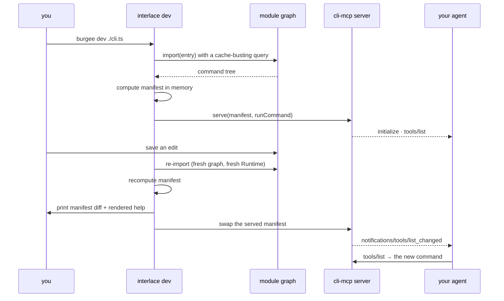

# Design — `dev-loop`

Intent: [`intent.md`](./intent.md). **Status:** review — built, W1–W6 verified.

**Restated:** 2026-10-18 — see § Restated 2026-10-18

---

## Restated 2026-10-18

**W1, W2, W3 and W5 held (W2 and W3 restated); W4 and the save segment of W6 have no check — REMAINING: W4 byte-identical-after-removal test, W6 save-to-reload segment untimed.**

The header's "W1–W6 verified" predates the 2026-09-09 pass in the intent, which found W2's
conformance case, W3's full manifest and W4's byte-identity unbuilt.

| ID | promised | on main | check | disposition |
| :-- | :-- | :-- | :-- | :-- |
| W1 | watch, reload, fresh `Runtime` each time | yes; reloads serialised, newest served | `packages/burgee/src/dev.test.ts` › "serves the entry over MCP, and after an edit the new command is listed, announced, and called on its new handler"; `packages/burgee/src/dev.test.ts` › "serialises reloads that pile up during one, and serves the newest"; `.sdlc/models/dev-reload.qnt` (`safety`, run by `models.yml`) | held |
| W2 | MCP on stdio via `cli-mcp`'s server; `tools/list_changed` on every reload | yes (`startMcp()` in `mcp.ts`) | `packages/burgee/src/dev.test.ts` › "reloads on its own when the watched entry changes" | restated (dev suite, not conformance) |
| W3 | each reload prints the manifest and the rendered help | a summary, a diff by command path, the rendered help | `packages/burgee/src/dev-load.test.ts` › "names a removed command with a minus", › "prints no help for a program with no root node, rather than a blank one" | restated |
| W4 | dev-time only, removable; a project that never runs it is byte-identical | `dev.js` denied on every shipped entry | `packages/burgee/src/weight.test.ts` › "reaches nothing on its denied list" | non-inclusion held; byte-identity remaining |
| W5 | no directory convention; watches the entry it is given | yes; source files only, `node_modules` ignored | `packages/burgee/src/dev-watch-filter.test.ts` › "ignores a file that is not source, and anything under node_modules", › "reloads when the platform does not name the file, since it may be the entry" | held |
| W6 | save-to-callable under 500 ms on 30 commands | reload-to-callable under max(500 ms, 5 imports) (A30) | `packages/burgee/src/dev.test.ts` › "reloads thirty commands within the budget" | budget restated and held; save-to-reload segment remaining |

See the intent's § Restated 2026-10-18 for the reasoning on each row.

## Requirements

| id | Requirement |
| :-- | :-- |
| W1 | `burgee dev <entry>` watches the entry's module graph and reloads on change, with a fresh `Runtime` each time |
| W2 | It serves MCP on stdio concurrently, using `cli-mcp`'s server, and emits `tools/list_changed` on every reload |
| W3 | Each reload prints the manifest and the rendered help, so one save shows every surface |
| W4 | It is dev-time only and fully removable (Z2); a project that never runs it is byte-identical |
| W5 | No directory convention: it watches the entry file it is given (Z1) |
| W6 | Save-to-agent-callable is under 500ms on the 30-command demo |

## Design

Reload is `import()` with a cache-busting query parameter on the entry, which discards the
module graph without a custom loader. Node's own `fs.watch` provides the trigger, so the
dev command adds no dependency (K1, constraint 3).

**Why the manifest makes this nearly free.** The manifest is already computed in memory at
startup by default (Z5), and every surface is a projection of it (`architecture.md` §1). A
reload is therefore: re-import, recompute, swap the reference, notify. There is no build
step to re-run because there is no build step.

**State isolation (constraint 4).** Each reload constructs a new `Runtime` and a new
command tree; the MCP server holds a reference that is swapped atomically between tool
calls. An in-flight call finishes against the tree it started on.

**Order of work.** Watch-and-reload printing the manifest first — useful on its own and it
proves the reload semantics. Then the MCP server alongside it. Then
`tools/list_changed`. Then the W6 benchmark.

## Verification

`packages/burgee/src/dev.test.ts` writes a temp CLI, starts `dev()` against a PassThrough
stdio pair, edits the file, and asserts: the new tool appears in `tools/list`,
`tools/list_changed` was emitted, the reload report names what was added and changed, and
a call is routed to the *new* handler rather than a cached one. A second case lets
`fs.watch` trigger the reload itself. W6 is measured: thirty commands, save to a call
answered by the new handler, under 500 ms (measured 20–40 ms).

Proven-red, per rule 4 (2026-09-08): the suite was run against `load()` without the
cache-busting query and all four cases failed — every reload answered from the cached
graph (`'one 29'` where `'two 29'` was expected). With the query, green.

W4 is a lock in `weight.test.ts`: `dev.js` is on the denied list of `.`, `./testing`,
`./commander` and `./yargs`, so nothing a shipped CLI imports can reach the dev loop; the
package's own CLI reaches it through a dynamic import, paid only on `burgee dev`.
*(2026-10-18: this holds non-inclusion; W4's "byte-identical" half has no test and is
remaining.)*

**Shipped 2026-09-08.** `burgee dev <entry>`: the entry exports `program` (or default) as
a burgee manifest, a commander `Command` or a yargs instance — all three are served, each
invoked the way its façade runs. Reloads are serialised (a save during a reload queues
the next); the report goes to stderr because stdout is the MCP channel; `--no-watch`
loads once and serves. `startMcp()` in `mcp.ts` is the swappable server `serveMcp()` now
wraps.

## Rejected alternatives

- **A directory convention (`src/commands/**`) so the watcher knows what to reload.** This
  is the first step toward oclif's shape and Z1 exists to prevent it. Watch the entry.
- **HMR that preserves handler state.** A CLI starts in milliseconds; a full reload is
  correct, simple, and cannot serve a stale closure.
- **A custom Node loader hook.** A cache-busting query does the same job with no loader,
  no flag, and no dependency.
- **HTTP transport for the dev MCP server.** Same reasoning as `cli-mcp`: a server
  lifecycle, auth and a network surface a CLI has no business owning.
- **Making `burgee dev` the documented entry point for new projects.** It is a
  convenience; the documented entry point is one file and `node cli.js` (Z4).

## Out of scope

- Watching and reloading *plugins* from other packages. Rung two of the ladder; the same
  mechanism will extend, but it is not needed to prove the loop.
- A TUI or dashboard. The output is a manifest diff and rendered help, printed.
- Production process management. This is a dev command and says so.
