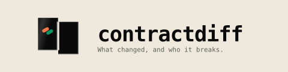

<p align="center">
  <a href="https://github.com/ofri-peretz/burgee/tree/main/packages/contractdiff" target="blank">
    <picture>
      <source media="(prefers-color-scheme: dark)" srcset="https://raw.githubusercontent.com/ofri-peretz/burgee/main/brand-assets/contractdiff-lockup.svg" />
      
    </picture>
  </a>
</p>

<p align="center">
  What changed in an API contract, who it breaks, and the code on both sides of it.
</p>

<p align="center">
  <a href="https://www.npmjs.com/package/contractdiff"></a>
  <a href="https://www.npmjs.com/package/contractdiff"></a>
  <a href="https://github.com/ofri-peretz/burgee/actions/workflows/quality.yml?query=branch%3Amain"></a>
  <a href="https://app.codecov.io/gh/ofri-peretz/burgee/components"></a>
  <a href="https://scorecard.dev/viewer/?uri=github.com/ofri-peretz/burgee"></a>
  <a href="https://www.npmjs.com/package/contractdiff?activeTab=code"></a>
  <a href="https://github.com/ofri-peretz/burgee/blob/main/packages/contractdiff/package.json"></a>
  <a href="https://github.com/ofri-peretz/burgee/blob/main/packages/contractdiff/package.json"></a>
  <a href="https://github.com/ofri-peretz/burgee/blob/main/packages/contractdiff/package.json"></a>
  <a href="https://github.com/ofri-peretz/burgee/blob/main/packages/contractdiff/LICENSE"></a>
  <a href="https://www.npmjs.com/package/contractdiff#provenance"></a>
</p>

<p align="center">
  Docs: <a href="https://burgee.interlace.tools/docs/packages/contractdiff">https://burgee.interlace.tools/docs/packages/contractdiff</a><br />
  Migrating from: <a href="https://github.com/ofri-peretz/burgee/tree/main/packages/contractdiff#migrating">openapi-typescript</a>
</p>

**contractdiff** reads an API contract (OpenAPI, Swagger 2.0, JSON Schema, AsyncAPI or an MCP tool
list) and does four things with it. `diff` says what a change breaks and for whom, under the
compatibility mode you pick. `lint` checks the contract's form with rules, Spectral and Redocly
rulesets included. `gen` writes code from it, one plugin per target: TypeScript types, truefit
validators, fetch and TanStack Query clients, MSW handlers and NestJS, Express, Fastify and Hono
servers. `extract` writes the contract back from the code. Every finding names its fix, as the same
record for a person, for `--json` and for a coding agent.

The `types` target writes what **openapi-typescript** writes, and `contractdiff migrate
openapi-typescript` turns its flags and `redocly.yaml` into a `contractdiff.config.json`, as
[Migrating](https://github.com/ofri-peretz/burgee/tree/main/packages/contractdiff#migrating) shows.

## Install

```bash
npm install contractdiff
pnpm add contractdiff
yarn add contractdiff
bun add contractdiff
```

Install it as a dev dependency (`-D`) of the project that owns the contract. The generated
validators import `truefit`, which comes with it.

## Quick start

```bash
npm install contractdiff
```

```js
import { mkdtempSync, writeFileSync } from "node:fs";
import { tmpdir } from "node:os";
import { join } from "node:path";
import { gen } from "contractdiff";

const dir = mkdtempSync(join(tmpdir(), "contractdiff-"));
const pet = { type: "object", required: ["name"], properties: { name: { type: "string" } } };
writeFileSync(
  join(dir, "openapi.json"),
  JSON.stringify({
    openapi: "3.1.0",
    info: { title: "Pets", version: "1.0.0" },
    paths: {
      "/pets/{id}": {
        get: {
          operationId: "getPet",
          parameters: [{ name: "id", in: "path", required: true, schema: { type: "string" } }],
          responses: { 200: { description: "A pet", content: { "application/json": { schema: pet } } } },
        },
      },
    },
  }),
);
writeFileSync(
  join(dir, "contractdiff.config.json"),
  JSON.stringify({ input: "openapi.json", targets: { types: { generator: "types", out: "src/api" } } }),
);

const report = await gen({ cwd: dir });
for (const file of report.files) console.log(`${file.action} ${file.path}`);
```

```text
write src/api/types.ts
write contractdiff.map.json
```

That is `npx contractdiff gen` in a project with that config. `npx contractdiff diff
git:main:openapi.json openapi.json` compares the contract on `main` with the one in the working tree,
and exits 1 when the change breaks a caller.

## What it does

- **`diff`** compares two versions of a contract, from files or `git:<ref>:<path>`, and classifies
  each change as breaking, dangerous or safe for the side you name, under `backward`, `forward` or
  `full` compatibility. `--transitive` checks a chain of releases.
- **`lint`** runs rules on a contract: its own `recommended` and `agent-ready` sets, and Spectral
  and Redocly rulesets read as they are.
- **`gen`** writes code from the contract, one plugin per target, and records every file and symbol
  it wrote in `contractdiff.map.json`, so the next run can tell its own files from yours.
- **`extract`** writes the contract back from your code, and `props` draws property tests from it.

## Migrating

`npx contractdiff migrate openapi-typescript` reads the scripts that run openapi-typescript and its
`redocly.yaml`, writes `contractdiff.config.json` with a `types` target in openapi-typescript's
compatibility mode, and rewrites the script:

```diff
  "scripts": {
-   "gen": "openapi-typescript openapi.yaml -o src/api/types.ts"
+   "gen": "contractdiff gen"
  }
```

It prints what it changed and what it could not carry, then `npm uninstall openapi-typescript`.
The same command reads openapi-fetch, Hey API and orval configs.

## Compatibility

Not graded on the published compatibility page yet. `contractdiff/openapi-typescript` passed 45 of 61 of openapi-typescript 7.13.0's own gated cases
when compat-oracle ran them on 2026-11-24 (openapi-typescript itself passes 61). It is not claimed as
a drop-in until it passes all 61. When the failures were last listed case by case (2026-11-18, 43
of 61), 7 passed the `transform`, `postTransform` or `transformProperty` options, which hand
TypeScript compiler nodes across and which the compiler-free generator refuses, and 9 spawned
openapi-typescript's own `./bin/cli.js`.
The `types` target is also measured against openapi-typescript's output on the corpus in
`benchmarks/apicontract`.

## Benchmarks

Every number here is produced by `npm run bench` and published at [burgee.interlace.tools/docs/benchmarks](https://burgee.interlace.tools/docs/benchmarks).

No suite is graded against this package yet, so there is no compatibility number to quote.

## For agents

- **`contractdiff explain <operation> --json`** prints one operation, message or tool with every
  `$ref` resolved and its size capped, so an agent calls it from the contract and not from memory.
- **`contractdiff lint --ruleset agent-ready`** checks whether a contract can be used as tools.
- **`--json`, `--schema` and an MCP server** come from one declaration on burgee:
  `contractdiff --mcp` serves the read-only commands as tools.
- **Exit codes are the contract.** `0` ok; `1` a finding, such as a breaking change; `2` a usage
  error; `3` a config that did not load, with the field to fix.
- **The docs are machine-readable** at
  [burgee.interlace.tools/llms.txt](https://burgee.interlace.tools/llms.txt).

## API

| Import                             | What it gives you                                                                  |
| :--------------------------------- | :--------------------------------------------------------------------------------- |
| `contractdiff`                     | `gen()`, `extract()`, `configSchema`, `MAP_FILE` and `program`                     |
| `contractdiff/core`                | the contract model every adapter reads into, and the `$ref` resolver              |
| `contractdiff/openapi`             | the OpenAPI adapter                                                                |
| `contractdiff/openapi-typescript`  | openapi-typescript's API over the `types` target                                   |
| `contractdiff/testing`             | `Plugin` and the conformance suite a plugin of your own runs                       |

The `contractdiff` bin is that API, declared once on burgee. `contractdiff plugin new <name>`
scaffolds a plugin that passes the conformance suite as written.

## Requirements

Node 22.13 or later. git, for `diff` against a ref. TypeScript in the project, for `lint` rules on
code and for `extract` from TypeScript sources.

## Where it sits

It hosts no plugin key of its own.

Nothing in this family builds on it yet, and it builds on `bellpull`, `burgee`, `seniority`, `truefit`.

## The family

18 packages, one repository, one release pipeline. Each installs and works on its own, and each owns
one job. Seven of them — `bellpull`, `closeout`, `linegauge`, `paratext`, `roundel`, `seniority`,
`truefit` — depend on nothing; the others depend only on packages in this table, and every
dependency points one way, down the [layers](https://burgee.interlace.tools/docs/concepts/family).

No package declares a dependency from outside the family; `react` and `react-reconciler` are
optional peers of `controlroom`, which npm does not install; `vitest` is an optional peer of
`oxmutate`, which npm does not install; `eslint` is an optional peer of `truepass`, which npm does
not install.
[`package-shape-lock`](https://github.com/ofri-peretz/burgee/blob/main/scripts/package-shape-lock.test.ts)
holds that for every manifest, and
[`independence-install-lock`](https://github.com/ofri-peretz/burgee/blob/main/scripts/independence-install-lock.test.ts)
installs each package alone and finds nothing but the family packages it declares.

Releases are published by one workflow through npm trusted publishing: no npm token is used, and
each release carries SLSA provenance, which `npm view <package> dist.attestations` shows.
[`trusted-publishing-lock`](https://github.com/ofri-peretz/burgee/blob/main/scripts/trusted-publishing-lock.test.ts)
keeps both true.

| Package | What it is | Migrates from |
| :-- | :-- | :-- |
| [burgee](https://burgee.interlace.tools/docs/packages/burgee) | The CLI framework: one declaration, every surface | commander, yargs and meow |
| [roundel](https://roundel.interlace.tools/docs) | Colour: one output policy, semantic tokens, a theme | chalk, colorette, kleur, picocolors, supports-color and yoctocolors |
| [flagstaff](https://flagstaff.interlace.tools/docs) | The frame loop: spinners, progress, boxes and tables | ora, log-update, boxen and cli-table3 |
| [caique](https://caique.interlace.tools/docs) | Prompts that are flags first, and never hang | @inquirer/core |
| [linegauge](https://linegauge.interlace.tools/docs) | Measuring, wrapping, truncating and slicing styled text | string-width, wrap-ansi, strip-ansi, slice-ansi, cli-truncate and widest-line |
| [paratext](https://paratext.interlace.tools/docs) | Hyperlinks, images, title, clipboard and notifications | ansi-escapes, terminal-link and term-img |
| [seniority](https://seniority.interlace.tools/docs) | Configuration precedence and discovery, with provenance | cosmiconfig, lilconfig, dotenv and rc |
| [closeout](https://closeout.interlace.tools/docs) | Exit handlers, terminal restore and a bounded shutdown | signal-exit, exit-hook, restore-cursor, cli-cursor and onetime |
| [bellpull](https://bellpull.interlace.tools/docs) | Subprocesses, and which executable actually ran | cross-spawn and which |
| [controlroom](https://controlroom.interlace.tools/docs) | Keyboard-driven terminal screens, inline or full-screen | ink |
| [oxmutate](https://oxmutate.interlace.tools/docs) | Mutation testing on the oxc engine, inside your own Vitest | Stryker |
| [truepass](https://burgee.interlace.tools/docs/packages/truepass) | Lint rules and a pre-push check that keep a test suite honest | @vitest/eslint-plugin |
| **contractdiff** (this package) | API contracts: breaking-change diff, lint, and code from the spec | openapi-typescript |
| [truefit](https://truefit.interlace.tools/docs) | Validation whose schemas are data, with no eval | zod |
| [provedone](https://burgee.interlace.tools/docs/packages/provedone) | A receipt for how every change was verified, and a gate that reads it | @commitlint/cli |
| [replz](https://burgee.interlace.tools/docs/packages/replz) | Recall of a reviewer and its checks, replayed on bugs that shipped | promptfoo |
| [hookset](https://burgee.interlace.tools/docs/packages/hookset) | The same git and Claude Code hooks in every repository, pinned by tag | husky |
| [triggerlist](https://burgee.interlace.tools/docs/packages/triggerlist) | The review checklist a diff selects, read from the base branch | danger |

Every migration guide, and the family-wide [compatibility](https://burgee.interlace.tools/docs/compatibility)
and [benchmarks](https://burgee.interlace.tools/docs/benchmarks) pages, are on
[burgee.interlace.tools](https://burgee.interlace.tools/docs/packages).

## Contributing

Issues and pull requests are welcome at [ofri-peretz/burgee](https://github.com/ofri-peretz/burgee/issues); read
[CONTRIBUTING.md](https://github.com/ofri-peretz/burgee/blob/main/CONTRIBUTING.md) first. Report a vulnerability privately, as
[SECURITY.md](https://github.com/ofri-peretz/burgee/blob/main/SECURITY.md) describes — never in a public issue.

## Licence

MIT © Ofri Peretz — see [LICENSE](https://github.com/ofri-peretz/burgee/blob/main/packages/contractdiff/LICENSE).
