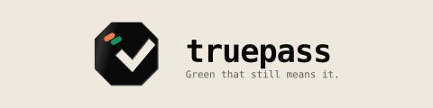

<p align="center">
  <a href="https://github.com/ofri-peretz/burgee/tree/main/packages/truepass" target="blank">
    <picture>
      <source media="(prefers-color-scheme: dark)" srcset="https://raw.githubusercontent.com/ofri-peretz/burgee/main/brand-assets/truepass-lockup.svg" />
      
    </picture>
  </a>
</p>

<p align="center">
  Green that still means it: a test suite cannot pass by checking less.
</p>

<p align="center">
  <a href="https://www.npmjs.com/package/truepass"></a>
  <a href="https://www.npmjs.com/package/truepass"></a>
  <a href="https://github.com/ofri-peretz/burgee/actions/workflows/quality.yml?query=branch%3Amain"></a>
  <a href="https://app.codecov.io/gh/ofri-peretz/burgee/components"></a>
  <a href="https://scorecard.dev/viewer/?uri=github.com/ofri-peretz/burgee"></a>
  <a href="https://www.npmjs.com/package/truepass?activeTab=code"></a>
  <a href="https://github.com/ofri-peretz/burgee/blob/main/packages/truepass/package.json"></a>
  <a href="https://github.com/ofri-peretz/burgee/blob/main/packages/truepass/package.json"></a>
  <a href="https://github.com/ofri-peretz/burgee/blob/main/packages/truepass/package.json"></a>
  <a href="https://github.com/ofri-peretz/burgee/blob/main/packages/truepass/LICENSE"></a>
  <a href="https://www.npmjs.com/package/truepass#provenance"></a>
</p>

<p align="center">
  Docs: <a href="https://burgee.interlace.tools/docs/packages/truepass">https://burgee.interlace.tools/docs/packages/truepass</a><br />
  Migrating from: <a href="https://github.com/ofri-peretz/burgee/tree/main/packages/truepass#migrating">@vitest/eslint-plugin</a>
</p>

**truepass** finds the ways a test suite is made to report green without the code passing. Its
ESLint rules catch what a test file says: a focused test, a skip with no reason, a fixed sleep, a
retry. Its `truepass diff` command catches what a change did: an assertion moved to a weaker
matcher on the same subject, and a snapshot rewritten with no reason in the commit message. Every
finding names its fix, as the same record for a person, for `--json` and for a coding agent.

It covers the focused- and disabled-test rules of **@vitest/eslint-plugin** under its own names,
and accepts a skip that says why it is skipped. Where you lint test files with
`@vitest/eslint-plugin` today, add `npx truepass diff` to your pre-push hook and switch the two
rules, as [Migrating](https://github.com/ofri-peretz/burgee/tree/main/packages/truepass#migrating)
shows.

## Install

```bash
npm install truepass
pnpm add truepass
yarn add truepass
bun add truepass
```

Install it as a dev dependency (`-D`) of the project whose tests it reads. ESLint 9 or later is an
optional peer: the rules run inside the project's own ESLint, and `truepass diff` needs only git.

## Quick start

```bash
npm install truepass
```

```js
import { parseUnifiedDiff, weakenedAssertions } from "truepass";

// What `git diff origin/main...HEAD` prints for a change that loosened one assertion.
const diff = `diff --git a/src/sum.test.ts b/src/sum.test.ts
--- a/src/sum.test.ts
+++ b/src/sum.test.ts
@@ -3 +3 @@
-  expect(sum(1, 2)).toBe(3);
+  expect(sum(1, 2)).toBeDefined();
`;

for (const f of weakenedAssertions(
  parseUnifiedDiff(diff),
  "fix: make CI green",
)) {
  console.log(`${f.path}:${f.line} ${f.message}`);
}
```

```text
src/sum.test.ts:3 Weakened assertion: expect(sum(1,2)) moved from .toBe() to the weaker .toBeDefined() in this change. fix: keep the strict matcher and fix the code, or assert the new exact value with .toBe(). If the looser claim is intended, add an "Assertion: <why>" line to the commit message.
```

That is the check `npx truepass diff` runs on the commits since `origin/main`, with the range's
own commit messages: it exits 1 on a finding and 0 on none.

## What it checks

| Check                          | Where           | Reports                                                                                  |
| :----------------------------- | :-------------- | :--------------------------------------------------------------------------------------- |
| `truepass/no-focused-test`     | ESLint          | `.only`, `fit`, `fdescribe`                                                              |
| `truepass/no-unexplained-skip` | ESLint          | `.skip`, `.todo`, `xit` and a constant `skipIf`, with no issue link, decision id or date |
| `truepass/no-fixed-sleep`      | ESLint          | `setTimeout` promises, `sleep(n)`, `waitForTimeout`                                      |
| `truepass/no-test-retry`       | ESLint          | `retry` / `retries` in tests and runner configs, `jest.retryTimes`                       |
| `weakened-assertion`           | `truepass diff` | an `expect(x)` moved to a weaker matcher; `Assertion: <why>` in a commit accepts it      |
| `unexplained-snapshot`         | `truepass diff` | a snapshot file changed with no `Snapshot: <why>` line in the range's commits            |

A call counts as a test only when its root is a test-runner name that is an unbound global or is
imported from a test-runner module, so a program's own `only()` is never reported.

```js
// eslint.config.js
import { configs } from "truepass/eslint";

export default [{ files: ["**/*.test.*"], ...configs.recommended }];
```

`configs.adoption` sets every rule to `warn`, for a repository paying down a backlog with
`--max-warnings` as the ratchet.

```yaml
# lefthook.yml
pre-push:
  commands:
    truepass:
      run: npx truepass diff --base origin/main
```

## Migrating

The switch is one command, `npx truepass diff` in the pre-push hook, and a rule rename in the lint
config:

```diff
- import vitest from "@vitest/eslint-plugin";
+ import { configs } from "truepass/eslint";

  export default [
-   { plugins: { vitest }, rules: { "vitest/no-focused-tests": "error", "vitest/no-disabled-tests": "error" } },
+   { files: ["**/*.test.*"], ...configs.recommended },
  ];
```

`no-unexplained-skip` accepts a skip whose comment, on its line or the line above, carries an issue
link, a decision id or an unexpired date; `no-disabled-tests` reports every one.

## Compatibility

Not graded: truepass reads test files and diffs, and no suite is graded against it. It runs on
ESLint 9 and 10 flat configs, and on Vitest, Jest, Mocha and Playwright test files.

## Benchmarks

Every number here is produced by `npm run bench` and published at [burgee.interlace.tools/docs/benchmarks](https://burgee.interlace.tools/docs/benchmarks).

No suite is graded against this package yet, so there is no compatibility number to quote.

## For agents

- **`truepass diff --json`** prints the findings as burgee's `--json` envelope: check, path, line
  and a message that ends in `fix:`.
- **`--json`, `--schema` and an MCP server** come from one declaration on burgee:
  `truepass --mcp` serves `diff` as a read-only tool.
- **Exit codes are the contract.** `0` no findings; `1` a finding; `2` a usage error, such as a
  base this checkout does not have, with the `git fetch` to run.
- **The docs are machine-readable** at
  [burgee.interlace.tools/llms.txt](https://burgee.interlace.tools/llms.txt).

## API

| Import            | What it gives you                                                                                               |
| :---------------- | :-------------------------------------------------------------------------------------------------------------- |
| `truepass`        | `check()`, `parseUnifiedDiff()`, `weakenedAssertions()`, `unexplainedSnapshots()`, `MATCHER_RANK` and `program` |
| `truepass/eslint` | `plugin`, `rules` and `configs` (`recommended`, `adoption`)                                                     |

The `truepass` bin is that API, declared once on burgee.

## Requirements

Node 22.13 or later. git, for `truepass diff`. ESLint 9 or later in the project, for the rules.

## Where it sits

It hosts no plugin key of its own.

Nothing in this family builds on it yet, and it builds on `bellpull` and `burgee`.

## The family

16 packages, one repository, one release pipeline. Each installs and works on its own, and each owns
one job. Seven of them — `bellpull`, `closeout`, `linegauge`, `paratext`, `roundel`, `seniority`,
`truefit` — depend on nothing; the others depend only on packages in this table, and every
dependency points one way, down the [layers](https://burgee.interlace.tools/docs/concepts/family).

No package declares a dependency from outside the family; `react` and `react-reconciler` are
optional peers of `controlroom`, which npm does not install; `vitest` is an optional peer of
`oxmutate`, which npm does not install; `eslint` is an optional peer of `truepass`, which npm does
not install.
[`package-shape-lock`](https://github.com/ofri-peretz/burgee/blob/main/scripts/package-shape-lock.test.ts)
holds that for every manifest, and
[`independence-install-lock`](https://github.com/ofri-peretz/burgee/blob/main/scripts/independence-install-lock.test.ts)
installs each package alone and finds nothing but the family packages it declares.

Releases are published by one workflow through npm trusted publishing: no npm token is used, and
each release carries SLSA provenance, which `npm view <package> dist.attestations` shows.
[`trusted-publishing-lock`](https://github.com/ofri-peretz/burgee/blob/main/scripts/trusted-publishing-lock.test.ts)
keeps both true.

| Package | What it is | Migrates from |
| :-- | :-- | :-- |
| [burgee](https://burgee.interlace.tools/docs/packages/burgee) | The CLI framework: one declaration, every surface | commander, yargs and meow |
| [roundel](https://roundel.interlace.tools/docs) | Colour: one output policy, semantic tokens, a theme | chalk, colorette, kleur, picocolors, supports-color and yoctocolors |
| [flagstaff](https://flagstaff.interlace.tools/docs) | The frame loop: spinners, progress, boxes and tables | ora, log-update, boxen and cli-table3 |
| [caique](https://caique.interlace.tools/docs) | Prompts that are flags first, and never hang | @inquirer/core |
| [linegauge](https://linegauge.interlace.tools/docs) | Measuring, wrapping, truncating and slicing styled text | string-width, wrap-ansi, strip-ansi, slice-ansi, cli-truncate and widest-line |
| [paratext](https://paratext.interlace.tools/docs) | Hyperlinks, images, title, clipboard and notifications | ansi-escapes, terminal-link and term-img |
| [seniority](https://seniority.interlace.tools/docs) | Configuration precedence and discovery, with provenance | cosmiconfig, lilconfig, dotenv and rc |
| [closeout](https://closeout.interlace.tools/docs) | Exit handlers, terminal restore and a bounded shutdown | signal-exit, exit-hook, restore-cursor, cli-cursor and onetime |
| [bellpull](https://bellpull.interlace.tools/docs) | Subprocesses, and which executable actually ran | cross-spawn and which |
| [controlroom](https://controlroom.interlace.tools/docs) | Keyboard-driven terminal screens, inline or full-screen | ink |
| [oxmutate](https://oxmutate.interlace.tools/docs) | Mutation testing on the oxc engine, inside your own Vitest | Stryker |
| **truepass** (this package) | Lint rules and a pre-push check that keep a test suite honest | @vitest/eslint-plugin |
| [contractdiff](https://burgee.interlace.tools/docs/packages/contractdiff) | API contracts: breaking-change diff, lint, and code from the spec | openapi-typescript |
| [truefit](https://burgee.interlace.tools/docs/packages/truefit) | Validation whose schemas are data, with no eval | zod |
| [provedone](https://burgee.interlace.tools/docs/packages/provedone) | A receipt for how every change was verified, and a gate that reads it | @commitlint/cli |
| [replz](https://burgee.interlace.tools/docs/packages/replz) | Recall of a reviewer and its checks, replayed on bugs that shipped | promptfoo |

Every migration guide, and the family-wide [compatibility](https://burgee.interlace.tools/docs/compatibility)
and [benchmarks](https://burgee.interlace.tools/docs/benchmarks) pages, are on
[burgee.interlace.tools](https://burgee.interlace.tools/docs/packages).

## Contributing

Issues and pull requests are welcome at [ofri-peretz/burgee](https://github.com/ofri-peretz/burgee/issues); read
[CONTRIBUTING.md](https://github.com/ofri-peretz/burgee/blob/main/CONTRIBUTING.md) first. Report a vulnerability privately, as
[SECURITY.md](https://github.com/ofri-peretz/burgee/blob/main/SECURITY.md) describes — never in a public issue.

## Licence

MIT © Ofri Peretz — see [LICENSE](https://github.com/ofri-peretz/burgee/blob/main/packages/truepass/LICENSE).
